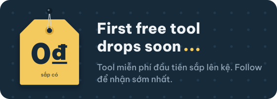
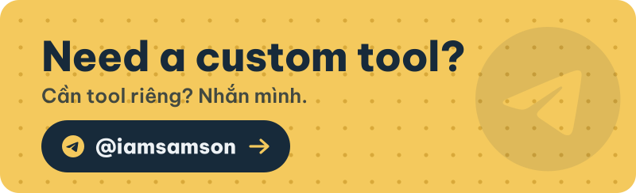
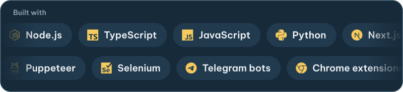

<picture>
<source media="(prefers-color-scheme: dark)" srcset="https://raw.githubusercontent.com/kinsamson0101/kinsamson0101/main/assets/heading-tools-dark.svg">

</picture>

<!-- TOOLS:START -->

<!-- TOOLS:END -->

