I build automation for people who earn online: bots, auto-job runners, scrapers, browser automation.
The tools that hold up in daily use get cleaned up and released here, free.

<b>Đọc bằng tiếng Việt</b>

 

Mình làm tool tự động hoá cho dân MMO: bot, tool chạy job, tool cào dữ liệu, tự động hoá trình duyệt.
Tool nào chạy ổn ngoài thực tế sẽ được dọn code và public miễn phí ở đây.

- Tool ở đây miễn phí, và sẽ luôn miễn phí. Không key, không giới hạn ngày dùng.
- Mã nguồn mở toàn bộ. Tool không gửi cookie, token hay mật khẩu của bạn đi đâu ngoài chính nền tảng bạn đang chạy. Bạn tự soi code được.
- Cần tool riêng theo cách bạn làm, thêm tính năng cho tool có sẵn, hoặc cần cài đặt giúp? Nhắn [Telegram](https://t.me/YOUR_TELEGRAM).

### Free tools

<!-- TOOLS:START -->

<i>The first tool is on its way. Follow this profile to see it the day it ships.</i>

<!-- TOOLS:END -->

### What you can count on

- **Open source, start to finish.** Every release is built from the code in its repo. No obfuscated files, no download-only builds.
- **Your accounts stay yours.** Tools never send cookies, tokens, or passwords anywhere except the platform you point them at.
- **Free stays free.** No license keys, no trial timers, no "pro unlock" hidden inside a free tool.
- **Automation has risks.** Platforms can limit or ban automated accounts. Read each repo's notes before you run it, and start on accounts you can afford to lose.

### Need more than the free version?

I also build private tools to order:

- a tool shaped around your own workflow
- extra features on top of a free tool from this page
- remote setup, so the tool runs on your machine

Message me on [Telegram](https://t.me/YOUR_TELEGRAM) with what you want automated.

### Built with

If a tool saves you time, star its repo. Stars are how other people find it.
